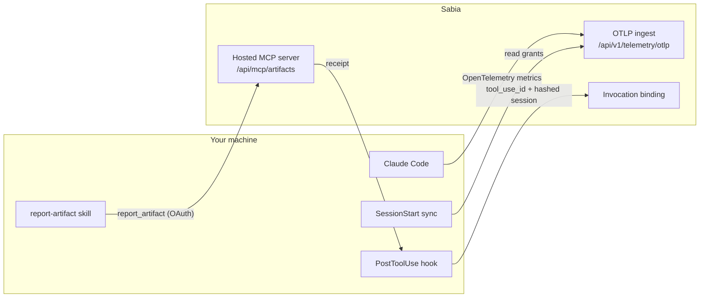

# Sabia for Claude Code

Output Reporting records completed actions on durable work, such as documents,
pull requests and presentations. Creating a document and later materially editing
it produces two Outputs linked to one Artifact. A generated response or trace
alone does not qualify.

**See what Claude Code actually shipped, and what it cost to ship it.**

[](https://github.com/Sabia-Partners/sabia-claude-plugin/actions/workflows/ci.yml)
[](LICENSE)


Sabia is AI Work Intelligence for teams. This plugin connects Claude Code to
your team's Sabia workspace in two ways, and you approve each one separately:

- **Output Reporting.** When Claude Code opens a pull request, files an
  issue or revises a document, it records that work in Sabia.
- **Native usage.** Claude Code's built-in OpenTelemetry token counts go to
  Sabia, including Max and Pro subscription usage that never appears in
  Anthropic's API cost reports.

With both connected, Sabia links each piece of work to the session and tokens
that produced it.

## Quick start

```text
/plugin marketplace add Sabia-Partners/sabia-claude-plugin
/plugin install sabia@sabia
```

Then ask Claude to **"connect Sabia"** for native usage, and run `/mcp` →
`plugin:sabia:sabia-artifacts` to connect Output Reporting. [SETUP.md](SETUP.md) walks through both, step by step.
Needs Claude Code 2.1.81 or later. For Claude on the web, Desktop and mobile, see
[Connect Claude to Sabia](https://app2.sabiapartners.ca/help/claude).

You need a Sabia workspace. Talk to [Sabia Partners](https://sabiapartners.ca/contact)
if your team does not have one yet.

Before 0.6.0 this plugin was called `sabia-claude-code-otel`. The marketplace
moves an existing install to the new name; if yours still shows the old one,
uninstall it and install `sabia@sabia`. Your native usage connection is kept,
because it lives in `~/.claude/settings.json` and `~/.claude/sabia-otel-state.json`
rather than in the plugin. Output Reporting needs one new sign-in through `/mcp`.

## What leaves your machine

Nothing is sent until you connect. After that, only what the table shows for
your connection is sent, and only to Sabia (`app2.sabiapartners.ca`). This
plugin never turns on prompt text or assistant responses, and never reads your
Claude chat history, memory or transcripts. The
[privacy notice](https://app2.sabiapartners.ca/privacy/claude-code) covers what
Sabia keeps and for how long.

| Connection | Sent to Sabia | Never sent |
| --- | --- | --- |
| **Output Reporting** | For each completed piece of work: an action, a short title, the artifact type, its provider reference and identifiers, and available evidence references. | Document bodies, prompts, transcripts, file contents. |
| **Native usage** (default) | Token counts from Claude Code's OpenTelemetry **metrics** export. | Prompts, responses, tool arguments, file contents. Log and trace exporters stay `none`. |
| **Report binding** (both connected) | The report's `tool_use_id` and a SHA-256 of the session id, hashed on this machine. | The raw session id, transcript, tool input, usage values. |

Titles and references can still contain sensitive information, so review what
Claude reports the same way you would review a commit message.

### Opt-in tool-output grant

One more grant widens native usage. It is off by default, needs an owner or
administrator of your Sabia organization to approve it in the browser, and is
recorded on the connection's key rather than on this machine.

| Grant | Adds | Still never sent |
| --- | --- | --- |
| **Tool output** (`--tool-output`) | Tool result bodies and the command lines that produced them, so work like `gh pr create` shows on Sabia's Output page. Claude Code's tool events from its log export, with each tool's arguments, MCP server and tool names, and skill names, so a connector update and the skills a session used can be identified. Claude Code redacts prompt text in those events. Sabia keeps a reduced extract per tool and drops file-tool bodies. For a successful connector action that creates or changes something in a supported Work Source (Google Drive and GitHub, plus the sources Sabia lists in its connector hook contract), a local hook also sends the identifiers from its reply: file, pull request or record ids, keys, names and links. | Prompt text, assistant responses, raw API bodies, connector replies themselves. |

Everyone in your Sabia organization can read what this grant captures.

> [!IMPORTANT]
> The grant is managed in Sabia, and an owner or administrator can change
> it later in **Settings → Usage connections**. Narrowing
> applies at the device's next session start without asking. **Widening never
> applies without you**: the plugin shows the request at each session start, and
> nothing more is exported until you approve it on this device (ask Claude, or
> run `approve`). To stop sharing, run `disconnect` or remove the device in Sabia.

## How it works



| Piece | What it does |
| --- | --- |
| [`.mcp.json`](.mcp.json) | Bundles Sabia's hosted MCP server as `sabia-artifacts`. It is HTTP with OAuth, and nothing runs locally. |
| [`skills/report-artifact`](skills/report-artifact/SKILL.md) | Tells Claude when a completed create, update, send, publish or deliver is worth reporting, and how to report it. |
| [`skills/connect-sabia`](skills/connect-sabia/SKILL.md) | Connects, checks, rotates and disconnects native usage. |
| [`scripts/sabia.mjs`](scripts/sabia.mjs) | Writes and removes the managed OpenTelemetry block in `settings.json`. Unrelated keys are preserved. |
| [`scripts/sabia-report-binding.mjs`](scripts/sabia-report-binding.mjs) | Links an accepted report to the tool call and session that made it. |
| [`scripts/sabia-connector-hook.mjs`](scripts/sabia-connector-hook.mjs) | Under the tool-output grant only: after a successful connector mutation, sends the identifiers in its reply. Claude Code exports connector arguments but never their results, so without it a Doc created through the Drive connector cannot be identified. Which operations count and which identifiers it keeps come from Sabia's connector hook contract, fetched with the native usage key, cached for 24 hours and replaced by the last good copy, then the bundled v1 contract, when Sabia cannot be reached. Reads, other connectors and failed calls send nothing; there is no retry spool. |
| [`hooks/hooks.json`](hooks/hooks.json) | Runs `sync` and the binding retry at session start, the binding after `report_artifact`, and the connector hook after MCP tools. |

### Everything this plugin runs, sends and fetches

Every request goes to one Sabia host: `app2.sabiapartners.ca` by default, or
the `--base-url` you connected with. Nothing else is contacted, and no code or
instructions are downloaded.

| When | Runs | Network | Writes |
| --- | --- | --- | --- |
| You ask to connect (`connect-sabia` skill) | `scripts/sabia.mjs connect`, which opens your browser with `open`, `xdg-open` or `start` | `POST /api/v1/telemetry/connect`, then polls `GET /api/v1/telemetry/connect/<id>` until you approve | The `env` block in `~/.claude/settings.json` and `~/.claude/sabia-otel-state.json`, mode 0600 |
| Every session start | `scripts/sabia.mjs sync --quiet` and `scripts/sabia-report-binding.mjs` | `GET /api/v1/telemetry/connection` (the grants for this key); retries of queued report bindings | The settings and `~/.claude/sabia-otel-state.json` when a grant narrowed or a wider one is waiting; the report-binding queue as items are sent or expire |
| Claude Code itself, once connected | Nothing extra | Token metrics to `/api/v1/telemetry/otlp`; under the tool-output grant, log records to the same endpoint and traces to `/api/v1/telemetry/traces` | Nothing |
| After `report_artifact` | `scripts/sabia-report-binding.mjs` | `POST /api/v1/artifact-reporting/claude-code-invocation` | A retry queue in the plugin's data directory |
| After any MCP tool call | `scripts/sabia-connector-hook.mjs`, which exits at once unless the tool-output grant is on and the call was a successful connector create or update | `GET /api/v1/telemetry/claude-code/hooks/contract` (a JSON allowlist of operations, at most daily), `POST /api/v1/telemetry/claude-code/hooks` | The contract cache in the plugin's data directory, and a retry-pause marker in the system temporary directory |
| You approve a wider grant (`approve`) | `scripts/sabia.mjs approve` | `GET /api/v1/telemetry/connection` | The settings and `~/.claude/sabia-otel-state.json` |
| You run `disconnect` | `scripts/sabia.mjs disconnect` | `DELETE /api/v1/telemetry/connection` | Restores the settings you had before |
| You use Output Reporting | Nothing local | The hosted MCP server `/api/mcp/artifacts`, signed in with OAuth through `/mcp` | Claude Code's own OAuth token store |

A report records that work was done. It never performs the work, and a
reporting failure never means the original operation failed.

## Commands

The `connect-sabia` skill runs these for you. You can also run them from the
plugin directory:

```text
node scripts/sabia.mjs connect      # browser approval, writes the exporter settings
node scripts/sabia.mjs status       # organization, endpoint and active grants
node scripts/sabia.mjs sync         # apply narrowed grants, show requested widenings
node scripts/sabia.mjs approve      # accept a wider grant your administrator requested
node scripts/sabia.mjs disconnect   # revoke the key and restore previous settings
```

Claude Code reads its environment when a session starts, so **start a new
session** after connecting. Settings live in `$CLAUDE_CONFIG_DIR` when that is
set, and in `~/.claude` otherwise.

## Uninstall

1. `node scripts/sabia.mjs disconnect` revokes the native usage key and
   restores whatever the managed variables held before.
2. `/mcp` → `plugin:sabia:sabia-artifacts` → *Clear authentication* disconnects reporting on
   this machine. Revoke it for good in Sabia → Settings → Connected Tools → Manage.
3. `/plugin uninstall sabia@sabia`.

Records Sabia already accepted stay in your workspace.

## Cloud sessions

Cloud sessions run on Anthropic's machines: claude.ai/code, `claude --cloud`,
the Desktop app's Cloud option and routines. They never read the
`settings.json` this plugin writes, so connecting on your computer does not
cover them. They send token counts to Sabia only when the exporter variables
are set on the cloud environment itself. This works on Pro, Max, Team and
Enterprise.

1. In Sabia, go to **Settings → Connected Tools**, select **Connect a tool**,
   then **Set up** on Claude Code, and select **Get cloud session values**. Sabia issues a key for
   your cloud sessions only and shows the variables once. Issuing again
   revokes the previous key.
2. At [claude.ai/code](https://claude.ai/code), open the environment selector
   under the message box. Edit one of your **Personal** environments, or add
   one.
3. Paste the variables into **Environment variables**.
4. Set **Network access** to **Custom** and add the Sabia host shown with the
   variables, for example `app2.sabiapartners.ca`. Check **Also include
   default list of common package managers** if your sessions install
   packages.
5. Start a new cloud session in that environment. Its usage appears under
   Claude Code in Sabia after a few minutes.

This sends the same metrics-only token counts as the default native usage
connection. Prompts, responses, tool arguments and file contents are not sent.
These steps do not set up Output Reporting for cloud sessions, and the
tool-output grant cannot be turned on for a cloud key: cloud sessions send no
traces, so it would stop Sabia counting their usage.

Keep the key in a **personal** environment. Anyone who can use an environment
can read its variables, and Sabia credits every session in it to the person
who issued the key. Never put it in an environment shared with your
organization. Claude Code does not pass `OTEL_*` variables to the commands it
runs, so code in the session cannot read the key.

Two other places that look right do not work. Network secrets never reach
Claude Code's telemetry export. A repository's `.claude/settings.json` cannot
turn telemetry on. A server-managed settings `env` block would also reach
every member's own computer and replace their personal keys, so Sabia does
not use it.

## Prompt text

This plugin never turns on prompt text. Claude Code includes it in its log
records only when `OTEL_LOG_USER_PROMPTS=1` is set, which the plugin never
writes, changes or removes. If your Sabia organization grants raw capture and
you choose to set it yourself, Sabia keeps the prompt text that arrives;
without that grant, Sabia drops it.

## Development

```text
pnpm install --frozen-lockfile
pnpm check
pnpm test
```

The tests cover connect, sync and disconnect against a local handoff server,
the plugin manifest, the report-binding hook and the connector
hook. The shared report contract is pinned in [`contracts/v2`](contracts/v2/README.md);
the connector hook's vendored contract and its identity-path parity cases, generated
from the dashboard's own projector, are in [`contracts/connector-hook`](contracts/connector-hook).
`identity-paths-v3.json` is a byte copy of the dashboard's
`tests/fixtures/claude-code-identity-paths-v3.json`; when the dashboard regenerates
it, copy it again rather than editing it here.

### Changing the connector hook contract

Clients cache the contract for 24 hours, and keep using the last good copy for as
long as Sabia cannot be reached, so the server never knows which contract a hook
is applying. Any change to `identityPaths` is therefore expand, deploy, contract,
the same rule as a database migration:

1. **Expand.** Add the new path, `as` name or operation beside the old one, and
   have the module read both.
2. **Deploy**, and wait at least one release (well past the 24-hour cache) so every
   connected hook has fetched the expanded contract.
3. **Contract.** Only then remove or rename the old declaration, or deactivate the
   module that declared it.

Never rename or remove an `as`, change its `kind`, or deactivate a module's paths
in a single release: a hook still on the old contract would send names the server
no longer declares, and the server rejects that whole subtree. The contract's own
shape is pinned on both sides (the dashboard's
`tests/unit/claude-code-identity-path-parity.test.ts` and this repository's
`parseConnectorContract`); this hook rejects a contract with any key, kind or cap it
does not know and falls back to its last good copy, so a new field needs a plugin
release that accepts it before the server may serve it.

To release, raise the version in `.claude-plugin/plugin.json` and
`package.json`, then tag `vX.Y.Z`. The release workflow runs the checks and
attaches `sabia-claude-plugin.tar.gz`. Claude Code only installs an update when
the plugin's version changes. The Claude Desktop extension and the Cowork helper
live in [Sabia-Partners/sabia-claude-desktop](https://github.com/Sabia-Partners/sabia-claude-desktop).


## Security and license

Report vulnerabilities privately. [SECURITY.md](SECURITY.md) explains how.
Support: [sabiapartners.ca/contact](https://sabiapartners.ca/contact) or
[hello@sabiapartners.ca](mailto:hello@sabiapartners.ca). Released under the
[MIT License](LICENSE).
